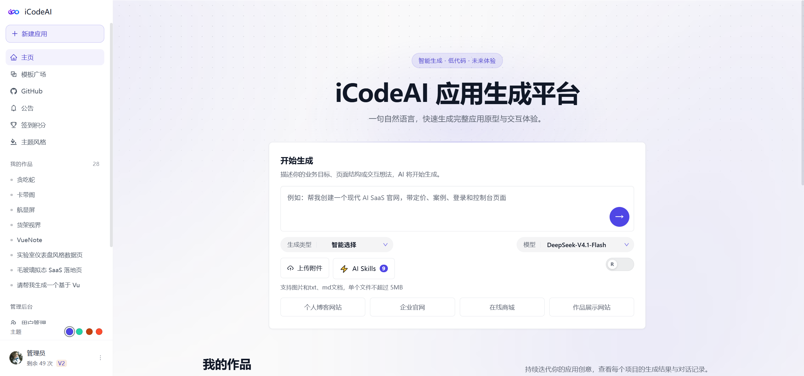
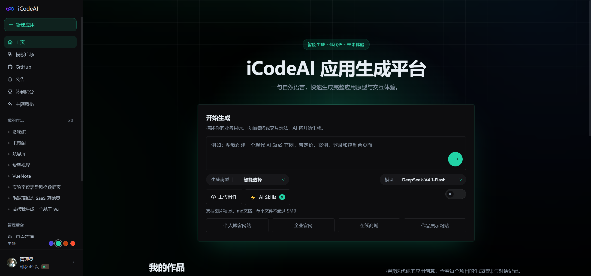
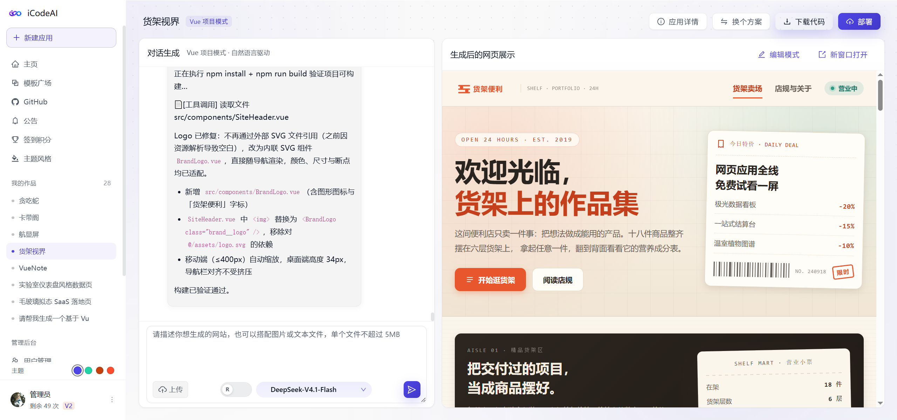
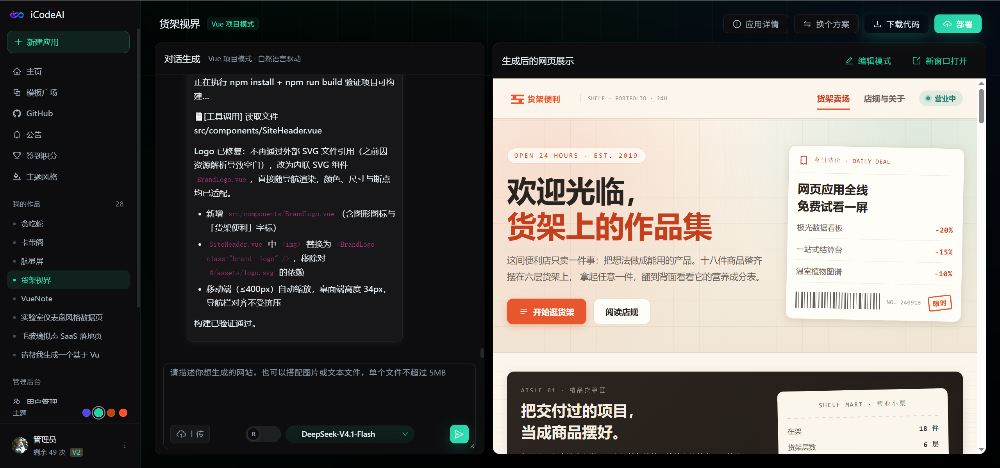
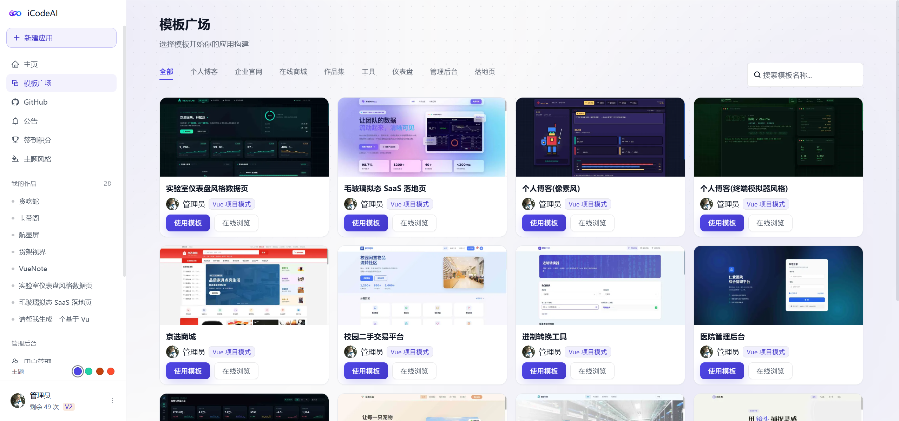
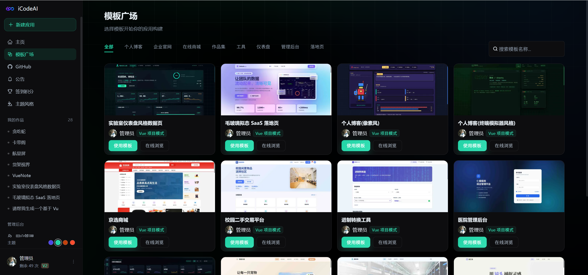

<p align="center">
  
</p>

<h1 align="center">iCodeAI</h1>

<p align="center"><b>Describe what you want in one sentence — AI generates a runnable, iterable, deployable web app</b></p>

<p align="center">
  <a href="README.md">简体中文</a> ·
  <b>English</b> ·
  <a href="http://www.icodeplay.site">Live Demo</a> ·
  <a href="#quick-start">Quick Start</a> ·
  <a href="#desktop-app">Desktop</a> ·
  <a href="https://github.com/20223309-zhou/ai-code-platform-frontend">Frontend Repo</a> ·
  <a href="https://github.com/20223309-zhou/ai-code-platform-backend-microservice">Microservices Edition</a>
</p>

<p align="center">
  
  
  
  
  
  
  
  
</p>

<p align="center">
  
  
  
  
  
  
</p>

---

> This repo is the **monolithic edition** — one process runs the whole business. For the service-split edition
> (Spring Cloud Alibaba + Gateway + OpenFeign + Nacos + RabbitMQ), see
> [ai-code-platform-backend-microservice](https://github.com/20223309-zhou/ai-code-platform-backend-microservice).

---

<table>
  <tr>
    <td align="center" width="25%">
      <b>Natural Language In</b><br />
      <sub>Describe the goal, get a full page<br />Single-file, multi-file, Vue or React project</sub>
    </td>
    <td align="center" width="25%">
      <b>Iterate by Chat</b><br />
      <sub>Refine over multiple turns, patch files<br />No need to regenerate everything</sub>
    </td>
    <td align="center" width="25%">
      <b>RAG Knowledge Base</b><br />
      <sub>Deployed projects indexed automatically<br />Retrieval scoped to the project type</sub>
    </td>
    <td align="center" width="25%">
      <b>Optional Desktop App</b><br />
      <sub>Electron shell with tray support<br />Parallel windows, tasks never interrupted</sub>
    </td>
  </tr>
</table>

---

## Screenshots

<p align="center">
  
  <br />
  
  <sub>Home — describe your idea, attach references, choose generation type and model; announcements, daily check-in and theme switching live in the sidebar</sub>
</p>

<p align="center">
  
  <br />
  
  <br />
  <sub>Chat — iterate with the AI on the left, watch the result render on the right</sub>
</p>

<p align="center">
  
  <br />
  
  <br />
  <sub>Template Gallery — browse curated templates and reuse one in a click</sub>
</p>

---

## Core Capabilities

### AI & Generation

- **Automatic routing**: a routing model decides whether to emit a single HTML file, a multi-file page, a Vue project, or a React project — or you can pin the type yourself
- **Multimodal input**: upload images (used as style reference) and txt / md files, or paste screenshots straight into the composer
- **Streaming output**: tokens are streamed as they arrive, including thinking process and tool-call messages; **stop generation** cuts the stream at its source (`StreamingHandle.cancel()`) and stops billing
- **Design plan presets**: when a request is open to interpretation, the model proposes several design directions first; unambiguous requests go straight to generation. Plans come from a separate lightweight model decoupled from the main code-generation model, and failures or timeouts degrade gracefully instead of blocking the flow
- **Conversation memory**: multi-turn context backed by Redis, with replay trimmed to a token budget so key constraints survive compression

### RAG Knowledge Base

- Deployed projects are indexed automatically and split per file type: Vue / React go through project-level splitting (React indexes whole files and prepends a Chinese feature description), HTML / JS / CSS go through text splitting
- Retrieval is filtered by the current generation type (`dynamicFilter`), so a Vue project never pulls in React snippets
- Embedding model `bge-small-zh-v1.5` (512-dim); vector store can be Qdrant or InMemory (with serialized persistence)
- `ConditionalContentRetriever` toggles retrieval at runtime — template reference can be switched off from the chat page at any time

### Function Calling

| Tool | Purpose |
| --- | --- |
| `FileReadTool` / `FileWriteTool` / `FileModifyTool` | Read, write and patch code files directly, so edits don't require full regeneration |
| `WebFetchTool` | Fetch external sites to reference their design style and layout |
| `activate_skill` | Load design guidelines and best practices on demand (Skills system) |

### Platform

- App preview, source download, one-click deployment
- Template gallery and template reuse
- **Announcement center**: the newest unread item pops up on entry, and a persistent sidebar entry lists every visible announcement and clears the badge; the frontend shares one copy per session (60-second staleness), while the backend caches visible announcements in Redis (30-minute TTL) and invalidates it on publish / edit / unpublish
- **Check-in & points**: daily check-in accrues points and tracks the streak, the points store redeems points for generation quota, and the points ledger is browsable
- **Theme system**: 4 themes (Graphite Pro / Terminal Teal / Warm Neutral / Swiss Type) driven by CSS variables — radius, shadow and transition change together with the palette
- VIP tiers with usage quota
- Admin console: user, app, conversation, announcement and log management plus statistics
- Input guardrails: prompt-injection detection and filtering

---

## Tech Stack

| Layer | Technology |
| --- | --- |
| Backend | Java 21 · Spring Boot 3.5.4 · MyBatis-Flex 1.11 · ShardingSphere 5.5 (primary/replica read-write splitting) · Redisson · Hutool 5.8 · Knife4j 4.4 |
| AI | LangChain4j 1.15 · Qdrant 1.17 · bge-small-zh-v1.5 |
| Storage | MySQL 8 (primary/replica) · Redis 7.2 (session / cache / conversation memory / distributed rate limiting) |
| Frontend | Vue 3.5 · Vite 7 · Ant Design Vue 4.2 · TypeScript 5.8 · Pinia 3 · Vue Router 4 |
| Desktop | Electron 33 · electron-builder (NSIS installer) |
| Microservices edition | Spring Cloud Alibaba 2025 · Gateway · OpenFeign · Nacos · RabbitMQ |

Model roles:

| Purpose | Model |
| --- | --- |
| Code generation / tool calls | DeepSeek `deepseek-v4.1-flash` (switchable to `grok-4.7` / `gpt-6.1-sol`) |
| Routing / intent classification | Qwen `qwen-flash` (100-token enum output) |
| Design plan presets | Qwen `qwen-flash` (2000 tokens, structured JSON) |
| Embeddings | BAAI `bge-small-zh-v1.5` |

---

## Project Structure

```text
ai-code-platform-backend/
├─ src/main/java/com/ai/codeplatform/
│  ├─ ai/           # AI services, model adapters, design plan generation
│  ├─ annotation/   # Custom annotations
│  ├─ aop/          # Aspects (auth, logging)
│  ├─ common/       # Unified responses and shared classes
│  ├─ config/       # Configuration (main / routing / plan models, cache, security, mail)
│  ├─ constant/     # Constants
│  ├─ controller/   # REST controllers
│  ├─ core/         # Code generation, parsing, persistence, build
│  ├─ exception/    # Exceptions and error codes
│  ├─ generator/    # Code generator
│  ├─ manager/      # COS storage, generation cancellation, etc.
│  ├─ mapper/       # Data access layer
│  ├─ model/        # DTO / Entity / VO
│  ├─ rag/          # Splitters (Vue / React / HTML / JS), document loader, retriever
│  ├─ ratelimiter/  # Rate limiting
│  ├─ service/      # Business services
│  └─ utils/        # Utilities
├─ src/main/resources/
│  ├─ application.yml / application-dev.yml / application-pro.yml
│  ├─ sharding-dev.yml / sharding-pro.yml   # Primary/replica read-write splitting rules
│  ├─ prompt/       # System prompts for HTML / multi-file / Vue / React / plan / routing
│  └─ skills/       # Built-in AI Skills
├─ sql/             # Full schema plus dated incremental scripts
└─ tmp/             # Generated code, build output, deployment artifacts
```

---

## Quick Start

### Requirements

- JDK 21, Maven 3.9+
- Node.js 18+, npm
- MySQL 8.x (the config expects a primary and a replica; for local debugging both can point at one instance)
- Redis 6/7
- Qdrant 1.17 (optional — InMemory fallback is available)
- For screenshots / deployment / object storage you also need an LLM API key, Tencent COS, and a browser capable of running Selenium

### 1. Initialize the database

```sql
CREATE DATABASE ai_code_platform DEFAULT CHARACTER SET utf8mb4;
```

For a fresh database run `sql/create_table.sql` (announcement and points tables included). For an existing one, apply the incremental scripts under `sql/` in date order:

```text
sql/2026-10-10_add_user_email.sql
sql/2026-10-29_add_announcement.sql
sql/2026-10-29_add_point_system.sql
```

### 2. Start the backend

```bash
mvn spring-boot:run
# On Windows you can also use: .\mvnw.cmd spring-boot:run
```

- API root: `http://localhost:8082/api`
- API docs: `http://localhost:8082/api/doc.html`

### 3. Start the frontend

```bash
cd ai-code-platform-frontend
npm install
npm run dev
```

Open `http://localhost:5173`. In development, Vite proxies `/api` to `http://localhost:8082`.

### Required configuration

The datasource is driven by ShardingSphere: `application-dev.yml` only holds the rule-file path, and the real connections live in `sharding-*.yml`.

| Setting | Location |
| --- | --- |
| MySQL primary / replica connections | `src/main/resources/sharding-dev.yml` (`master` / `slave`) |
| Redis connection | `src/main/resources/application-dev.yml` |
| LLM endpoint, model name, API key | `langchain4j` block in `application-dev.yml` |
| Mail authorization code (sign-up captcha) | `spring.mail` in `application-dev.yml` |
| COS object storage | `application-dev.yml` |
| App deployment domain | `application-dev.yml` (`code.deploy-path`) |

> The `dev` profile contains plaintext secrets and is for local use only. Production runs `application-pro.yml`, where sensitive values come from environment variables (`SPRING_MYSQL_*`, `SPRING_REDIS_*`, `MAIL_*`, etc.).

### Build

```bash
# Backend
mvn clean package -DskipTests

# Frontend
npm run build
```

---

## Desktop App

The same frontend can be packaged as a Windows desktop app with **zero backend changes**:

- The shell serves a local port that hosts the static assets and proxies `/api` — same-origin requests mean Session Cookies and preview iframes work without extra configuration
- Lives in the system tray: closing the window only hides it, so long-running generations are never interrupted
- **Parallel windows**: each app can be opened in its own window and generate concurrently; reopening the same app reuses the existing window instead of spawning another shell
- Four themes (including a dark one) and an app-style sidebar layout

Installers are published under [Releases](../../releases); the source lives on the `desktop` branch of [ai-code-platform-frontend](https://github.com/20223309-zhou/ai-code-platform-frontend).

---

## Main API Modules

| Controller | Responsibility |
| --- | --- |
| `UserController` | Sign up, sign in (graphical captcha / GitHub OAuth), profile, VIP tier and quota |
| `AppController` | App creation, AI generation (with `useRag`), cancel generation, download, deploy, template reuse, design plan presets |
| `ChatHistoryController` | Conversation history queries |
| `AnnouncementController` | Public visible announcements (no login required) plus admin CRUD and publish |
| `PointController` | Points account, daily check-in, store items, quota redemption, points ledger |
| `StatisticsController` | Creation trends, success rate, active users and other metrics |
| `SysOperationLogController` | Operation logs (admin) |

---

## License

```text
This project is for learning, experimentation, and graduation design purposes.
```
