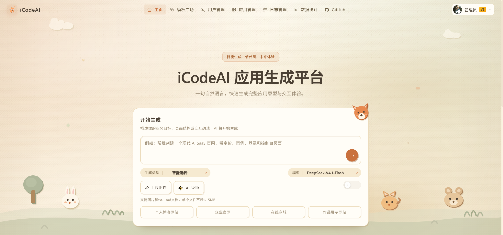
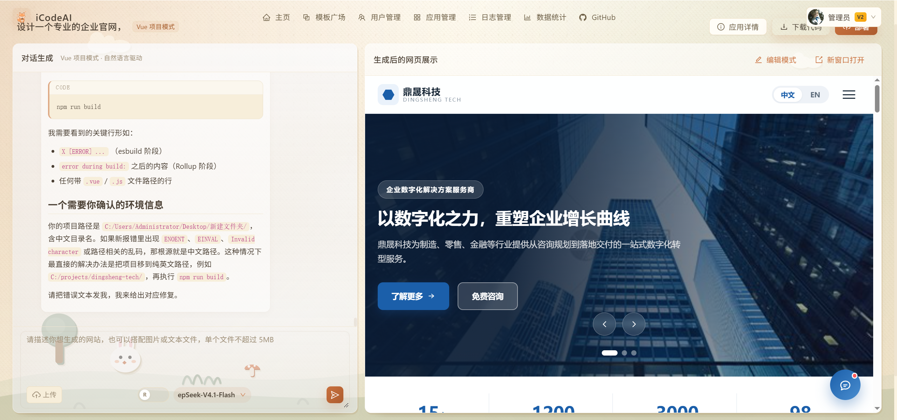
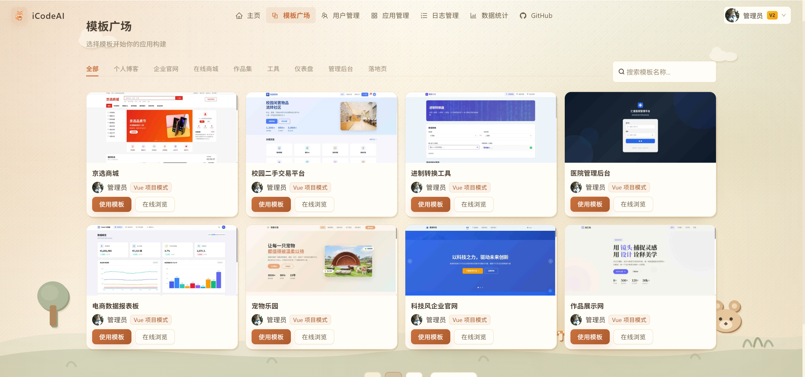

<p align="center">
  
</p>

<h1 align="center">iCodeAI</h1>

<p align="center"><b>Describe what you want in one sentence — AI generates a runnable, iterable, deployable web app</b></p>

<p align="center">
  <a href="README.md">简体中文</a> ·
  <b>English</b> ·
  <a href="http://www.icodeplay.site">Live Demo</a> ·
  <a href="#quick-start">Quick Start</a> ·
  <a href="#desktop-app">Desktop</a> ·
  <a href="https://github.com/20223309-zhou/ai-code-platform-frontend">Frontend Repo</a>
</p>

<p align="center">
  
  
  
  
  
  
  
</p>

<p align="center">
  
  
  
  
  
</p>

---

<table>
  <tr>
    <td align="center" width="25%">
      <b>Natural Language In</b><br />
      <sub>Describe the goal, get a full page<br />Single-file, multi-file, or Vue project</sub>
    </td>
    <td align="center" width="25%">
      <b>Iterate by Chat</b><br />
      <sub>Refine over multiple turns, patch files<br />No need to regenerate everything</sub>
    </td>
    <td align="center" width="25%">
      <b>RAG Knowledge Base</b><br />
      <sub>Deployed projects indexed automatically<br />New code follows similar implementations</sub>
    </td>
    <td align="center" width="25%">
      <b>Optional Desktop App</b><br />
      <sub>Electron shell with tray support<br />Long tasks never get interrupted</sub>
    </td>
  </tr>
</table>

---

## Screenshots

<p align="center">
  
  <br />
  <sub>Home — describe your idea, attach references, choose generation type and model</sub>
</p>

<p align="center">
  
  <br />
  <sub>Chat — iterate with the AI on the left, watch the result render on the right</sub>
</p>

<p align="center">
  
  <br />
  <sub>Template Gallery — browse curated templates and reuse one in a click</sub>
</p>

---

## Core Capabilities

### AI & Generation

- **Automatic routing**: a routing model decides whether to emit a single HTML file, a multi-file page, or a full Vue project — or you can pin the type yourself
- **Multimodal input**: upload images (used as style reference) and txt / md files, or paste screenshots straight into the composer
- **Streaming output**: tokens are streamed as they arrive, including thinking process and tool-call messages; **stop generation** cuts the stream at its source (`StreamingHandle.cancel()`) and stops billing
- **Design plan presets**: when a request is open to interpretation, the model proposes several design directions first; unambiguous requests go straight to generation. Failures or timeouts degrade gracefully instead of blocking the flow
- **Conversation memory**: multi-turn context backed by Redis — key constraints survive compression

### RAG Knowledge Base

- Deployed projects are indexed automatically, split by file type (Vue / HTML / JS / CSS)
- Embedding model `bge-small-zh-v1.5` (512-dim); vector store can be Qdrant or InMemory (with serialized persistence)
- `ConditionalContentRetriever` toggles retrieval at runtime — template reference can be switched off from the chat page at any time

### Function Calling

| Tool | Purpose |
| --- | --- |
| `FileReadTool` / `FileWriteTool` / `FileModifyTool` | Read, write and patch code files directly, so edits don't require full regeneration |
| `WebFetchTool` | Fetch external sites to reference their design style and layout |
| `activate_skill` | Load design guidelines and best practices on demand (Skills system) |

### Platform

- App preview, source download, one-click deployment
- Template gallery and template reuse
- VIP tiers with usage quota
- Admin console: user, app, conversation and log management plus statistics
- Input guardrails: prompt-injection detection and filtering

---

## Tech Stack

| Layer | Technology |
| --- | --- |
| Backend | Java 21 · Spring Boot 3.5.4 · MyBatis-Flex 1.11 · Hutool 5.8 · Knife4j 4.4 |
| AI | LangChain4j 1.15 · Qdrant 1.17 · bge-small-zh-v1.5 |
| Storage | MySQL 8 (business data) · Redis 7.2 (session / cache / conversation memory) |
| Frontend | Vue 3.5 · Vite 7 · Ant Design Vue 4.2 · TypeScript 5.8 · Pinia 3 · Vue Router 4 |
| Desktop | Electron 33 · electron-builder (NSIS installer) |

Model roles:

| Purpose | Model |
| --- | --- |
| Code generation / tool calls | DeepSeek `deepseek-v4-flash` |
| Routing / intent classification | Qwen-turbo |
| Embeddings | BAAI `bge-small-zh-v1.5` |

---

## Project Structure

```text
ai-code-platform-backend/
├─ src/main/java/com/ai/codeplatform/
│  ├─ ai/           # AI services, model adapters, design plan generation
│  ├─ annotation/   # Custom annotations
│  ├─ aop/          # Aspects (auth, logging)
│  ├─ common/       # Unified responses and shared classes
│  ├─ config/       # Configuration
│  ├─ controller/   # REST controllers
│  ├─ core/         # Code generation, parsing, persistence, build
│  ├─ rag/          # RAG: splitter, document loader, vector store, retriever
│  ├─ manager/      # COS storage, generation cancellation, etc.
│  ├─ mapper/       # Data access layer
│  ├─ model/        # DTO / Entity / VO
│  ├─ ratelimiter/  # Rate limiting
│  └─ service/      # Business services
├─ src/main/resources/
│  ├─ application.yml
│  ├─ prompt/       # System prompts for code and design plan generation
│  └─ skills/       # Built-in AI Skills
├─ sql/             # Table creation scripts
└─ tmp/             # Generated code, build output, deployment artifacts
```

---

## Quick Start

### Requirements

- JDK 21, Maven 3.9+
- Node.js 18+, npm
- MySQL 8.x, Redis 6/7
- Qdrant 1.17 (optional — InMemory fallback is available)
- For screenshots / deployment / object storage you also need an LLM API key, Tencent COS, and a browser capable of running Selenium

### 1. Initialize the database

```sql
CREATE DATABASE ai_code_platform DEFAULT CHARACTER SET utf8mb4;
```

Run the scripts under `sql/`, then update the datasource in `src/main/resources/application-dev.yml`.

### 2. Start the backend

```bash
mvn spring-boot:run
# On Windows you can also use: .\mvnw.cmd spring-boot:run
```

- API root: `http://localhost:8082/api`
- API docs: `http://localhost:8082/api/doc.html`

### 3. Start the frontend

```bash
cd ai-code-platform-frontend
npm install
npm run dev
```

Open `http://localhost:5173`. In development, Vite proxies `/api` to `http://localhost:8082`.

### Required configuration

| Setting | Location |
| --- | --- |
| MySQL / Redis connection | `src/main/resources/application-dev.yml` |
| LLM endpoint, model name, API key | `application-dev.yml` and the model config under `config/` |
| COS object storage | `application-dev.yml` |
| App deployment domain | `application-dev.yml` (`code.deploy-path`) |

### Build

```bash
# Backend
mvn clean package -DskipTests

# Frontend
npm run build
```

---

## Desktop App

The same frontend can be packaged as a Windows desktop app with **zero backend changes**:

- The shell serves a local port that hosts the static assets and proxies `/api` — same-origin requests mean Session Cookies and preview iframes work without extra configuration
- Lives in the system tray: closing the window only hides it, so long-running generations are never interrupted
- Four light themes and an app-style sidebar layout

Installers are published under [Releases](../../releases); the source lives on the `desktop` branch of [ai-code-platform-frontend](https://github.com/20223309-zhou/ai-code-platform-frontend).

---

## Main API Modules

| Controller | Responsibility |
| --- | --- |
| `UserController` | Sign up, sign in, captcha, profile, VIP tier and quota |
| `AppController` | App creation, AI generation (with `useRag`), cancel generation, download, deploy, template reuse, design plan presets |
| `ChatHistoryController` | Conversation history queries |
| `StatisticsController` | Creation trends, success rate, active users and other metrics |
| `OperationLogController` | Operation logs |

---

## License

```text
This project is for learning, experimentation, and graduation design purposes.
```
