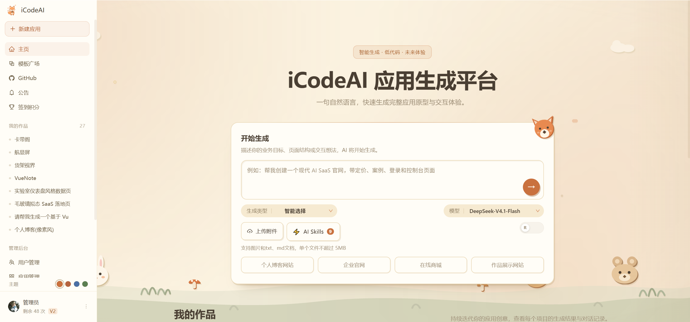
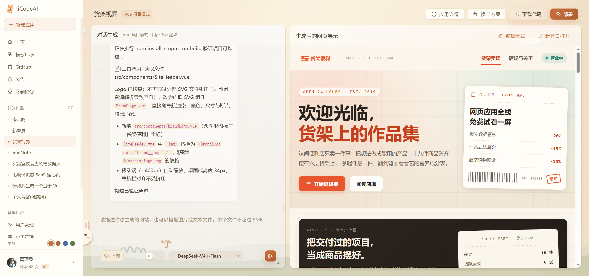
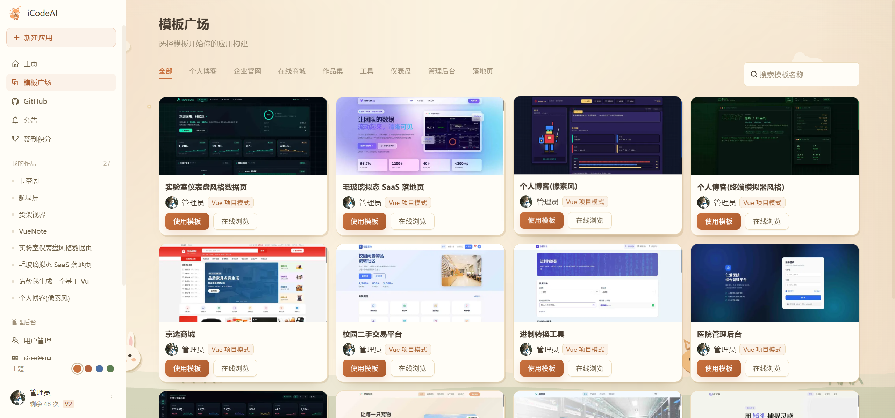

<p align="center">
  
</p>

<h1 align="center">iCodeAI</h1>

<p align="center"><b>一句话描述需求，AI 直接生成可运行、可迭代、可部署的网页应用</b></p>

<p align="center">
  <b>简体中文</b> ·
  <a href="README.en.md">English</a> ·
  <a href="http://www.icodeplay.site">在线体验</a> ·
  <a href="#快速开始">快速开始</a> ·
  <a href="#桌面端">桌面端</a> ·
  <a href="https://github.com/20223309-zhou/ai-code-platform-frontend">前端仓库</a>
</p>

<p align="center">
  
  
  
  
  
  
  
</p>

<p align="center">
  
  
  
  
  
</p>

---

<table>
  <tr>
    <td align="center" width="25%">
      <b>自然语言生成</b><br />
      <sub>描述业务目标即可出完整页面<br />支持单页、多文件与 Vue 工程</sub>
    </td>
    <td align="center" width="25%">
      <b>对话式迭代</b><br />
      <sub>多轮修改、局部改文件<br />不必每次推倒重来</sub>
    </td>
    <td align="center" width="25%">
      <b>RAG 知识库</b><br />
      <sub>已部署项目自动入库<br />生成时参考同类实现</sub>
    </td>
    <td align="center" width="25%">
      <b>桌面端可选</b><br />
      <sub>Electron 封装，托盘常驻<br />长任务不会被打断</sub>
    </td>
  </tr>
</table>

---

## 界面预览

<p align="center">
  
  <br />
  <sub>首页 —— 输入需求、上传参考资料、选择生成类型与模型</sub>
</p>

<p align="center">
  
  <br />
  <sub>对话页 —— 左侧与 AI 对话迭代，右侧实时预览生成结果</sub>
</p>

<p align="center">
  
  <br />
  <sub>模板广场 —— 浏览精选模板并一键复用</sub>
</p>

---

## 核心能力

### AI 与生成

- **生成类型自动路由**：由路由模型判断该产出单文件 HTML、多文件页面还是 Vue 工程，用户也可手动指定
- **多模态输入**：支持上传图片（识图取风格）与 txt / md 文本作为参考资料，也支持直接粘贴截图
- **流式输出**：生成过程逐段返回前端，包含思考过程与工具调用消息；支持**停止生成**（`StreamingHandle.cancel()` 在源头截断，同时终止计费）
- **方案预选**：需求存在设计分歧时，先生成多套设计方案供选择，需求明确则直接进入生成；失败或超时自动降级，不阻断主流程
- **会话记忆**：基于 Redis 的多轮上下文，压缩后仍保留关键约束

### RAG 知识库

- 已部署项目自动入库，按文件类型（Vue / HTML / JS / CSS）分割索引
- 嵌入模型 `bge-small-zh-v1.5`（512 维），向量库可选 Qdrant 或 InMemory（可持久化序列化）
- `ConditionalContentRetriever` 支持运行时开关，对话页可随时关闭模板参考

### Function Calling

| 工具 | 作用 |
| --- | --- |
| `FileReadTool` / `FileWriteTool` / `FileModifyTool` | AI 直接读写、局部修改代码文件，避免全量重新生成 |
| `WebFetchTool` | 主动访问外部网站，参考其设计风格与布局 |
| `activate_skill` | 按需加载设计规范与最佳实践（Skills 技能系统） |

### 平台能力

- 应用预览、源码下载、一键部署
- 模板广场与模板复用
- VIP 等级与使用额度控制
- 管理后台：用户、应用、对话、日志管理与数据统计可视化
- 输入安全护轨：Prompt 注入检测与过滤

---

## 技术栈

| 层次 | 技术 |
| --- | --- |
| 后端 | Java 21 · Spring Boot 3.5.4 · MyBatis-Flex 1.11 · Hutool 5.8 · Knife4j 4.4 |
| AI | LangChain4j 1.15 · Qdrant 1.17 · bge-small-zh-v1.5 |
| 存储 | MySQL 8（业务数据）· Redis 7.2（Session / 缓存 / 会话记忆） |
| 前端 | Vue 3.5 · Vite 7 · Ant Design Vue 4.2 · TypeScript 5.8 · Pinia 3 · Vue Router 4 |
| 桌面端 | Electron 33 · electron-builder（NSIS 安装包） |

模型分工：

| 用途 | 模型 |
| --- | --- |
| 代码生成 / 工具调用 | DeepSeek `deepseek-v4-flash` |
| 路由分类 / 意图识别 | Qwen-turbo |
| 向量嵌入 | BAAI `bge-small-zh-v1.5` |

---

## 项目结构

```text
ai-code-platform-backend/
├─ src/main/java/com/ai/codeplatform/
│  ├─ ai/           # AI 服务、模型适配、方案生成
│  ├─ annotation/   # 自定义注解
│  ├─ aop/          # 切面（鉴权、日志）
│  ├─ common/       # 统一返回与公共类
│  ├─ config/       # 配置类
│  ├─ controller/   # 控制器
│  ├─ core/         # 代码生成、解析、保存、构建
│  ├─ rag/          # RAG：分割器、文档加载、向量存储、检索器
│  ├─ manager/      # COS、生成任务取消等
│  ├─ mapper/       # 数据访问层
│  ├─ model/        # DTO / Entity / VO
│  ├─ ratelimiter/  # 限流
│  └─ service/      # 业务服务
├─ src/main/resources/
│  ├─ application.yml
│  ├─ prompt/       # 代码生成、方案生成的系统提示词
│  └─ skills/       # 平台内置 AI Skills
├─ sql/             # 建表语句
└─ tmp/             # 生成代码、构建输出、部署产物
```

---

## 快速开始

### 环境要求

- JDK 21、Maven 3.9+
- Node.js 18+、npm
- MySQL 8.x、Redis 6/7
- Qdrant 1.17（可选，可用 InMemory 回退）
- 完整跑通截图 / 部署 / 对象存储，另需大模型 API Key、腾讯云 COS、可运行 Selenium 的浏览器

### 1. 初始化数据库

```sql
CREATE DATABASE ai_code_platform DEFAULT CHARACTER SET utf8mb4;
```

执行仓库中的建表脚本 `sql/`，然后修改 `src/main/resources/application-dev.yml` 里的数据源配置。

### 2. 启动后端

```bash
mvn spring-boot:run
# Windows 可改用：.\mvnw.cmd spring-boot:run
```

- 接口根地址：`http://localhost:8082/api`
- 接口文档：`http://localhost:8082/api/doc.html`

### 3. 启动前端

```bash
cd ai-code-platform-frontend
npm install
npm run dev
```

访问 `http://localhost:5173`，开发环境由 Vite 把 `/api` 代理到 `http://localhost:8082`。

### 必改配置

| 配置项 | 位置 |
| --- | --- |
| MySQL / Redis 连接 | `src/main/resources/application-dev.yml` |
| 大模型地址、模型名、API Key | `application-dev.yml` 与 `config/` 下的模型配置 |
| COS 对象存储 | `application-dev.yml` |
| 应用部署域名 | `application-dev.yml`（对应 `code.deploy-path`） |

### 构建

```bash
# 后端
mvn clean package -DskipTests

# 前端
npm run build
```

---

## 桌面端

同一套前端可直接封装为 Windows 桌面应用，**后端无需改动**：

- 壳内启动本地服务，同一端口托管静态资源并代理 `/api`，请求算同站，Session Cookie 与预览 iframe 都不需要额外配置
- 系统托盘常驻：关闭窗口只是隐藏，AI 生成长任务不会被打断
- 4 套浅色主题、应用式侧边栏布局

安装包见 [Releases](../../releases)，源码在 [ai-code-platform-frontend](https://github.com/20223309-zhou/ai-code-platform-frontend) 的 `desktop` 分支。

---

## 主要接口模块

| 控制器 | 职责 |
| --- | --- |
| `UserController` | 注册、登录、验证码、个人信息、VIP 等级与额度 |
| `AppController` | 应用创建、AI 对话生成（含 `useRag`）、取消生成、下载、部署、模板复用、方案预选 |
| `ChatHistoryController` | 对话历史查询 |
| `StatisticsController` | 创作趋势、成功率、活跃用户等统计数据 |
| `OperationLogController` | 操作日志 |

---

## License

```text
This project is for learning, experimentation, and graduation design purposes.
```
